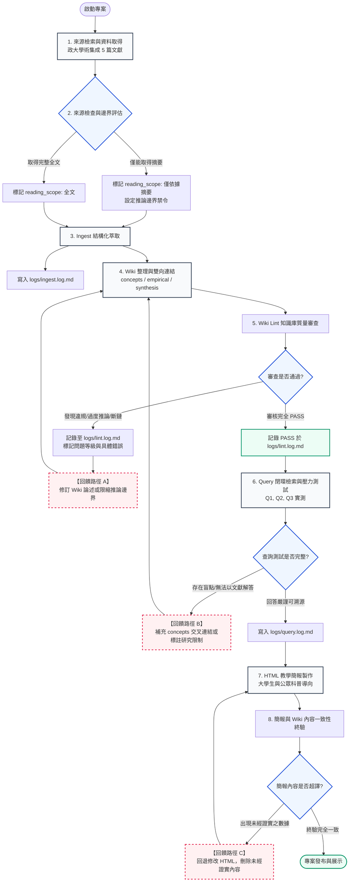

# LLM Wiki 工作流程與回饋修正機制 (workflow.md)

本文件定義「為什麼捷運站附近的房子比較貴？」專案之資料處理、知識建構、審計回饋與生成發布工作流。本流程強調「閉環回饋（Closed-loop Feedback）」，任何節點發現資訊不足或推論瑕疵，必須循指定回退路徑修正。

---

## 一、 工作流程圖 (Mermaid Closed-Loop Graph)

---

## 二、 具體回饋路徑說明 (Feedback Mechanisms)

### 1. 【回饋路徑 A】：Lint 審核未通過之回退機制
- **觸發條件**：
  - 出現未引證來源之孤立數值。
  - 將僅取得摘要之論文誤判為全文推論。
  - 踩中專案禁令（如：將溫弘裕 (2015) 誤寫為三期比較、將戴國正 (2011) 誤植噪音實證、將黃麟雅 (2017) 誤稱為環狀線、將陳品睿 (2025) 誤改為 TPASS）。
  - 出現 Wiki 頁面無效連結或斷鏈。
- **處理流程**：
  1. 在 `logs/lint.log.md` 記錄錯誤檔案、違規項目與問題嚴重性。
  2. 暫停下游工作，立即回到 `wiki/` 對應 Markdown 頁面修正敘述或移除不實數據。
  3. 修正後重新執行 Lint，直至完全通過（PASS）為止。

### 2. 【回饋路徑 B】：Query 壓力測試未通過之回退機制
- **觸發條件**：
  - 針對使用者常見的捷運房價提問（如「距離越近一定越貴嗎？」），發現 Wiki 無法給出有實證支持的完整回答，或無法清楚指出空間異質性。
- **處理流程**：
  1. 檢視是否遺漏了 `raw/` 中的重要觀點。
  2. 回退至 `wiki/concepts/` 或 `wiki/empirical-findings/`，深化概念間的交叉連結（Cross-link），或在論述中明確指出該問題在現有文獻中的實證限制。
  3. 重新進行 Query 測試並記錄於 `logs/query.log.md`。

### 3. 【回饋路徑 C】：HTML 簡報終驗一致性之回退機制
- **觸發條件**：
  - 簡報為了視覺效果或通俗化，出現未在 Wiki 中建立基礎的誇大文案或虛構圖表數據。
- **處理流程**：
  1. 對照 `source-matrix.md` 逐頁比對簡報內容。
  2. 發現超譯之處，強制回退修改簡報檔案，嚴格維持與知識庫一致的學術嚴謹度。
